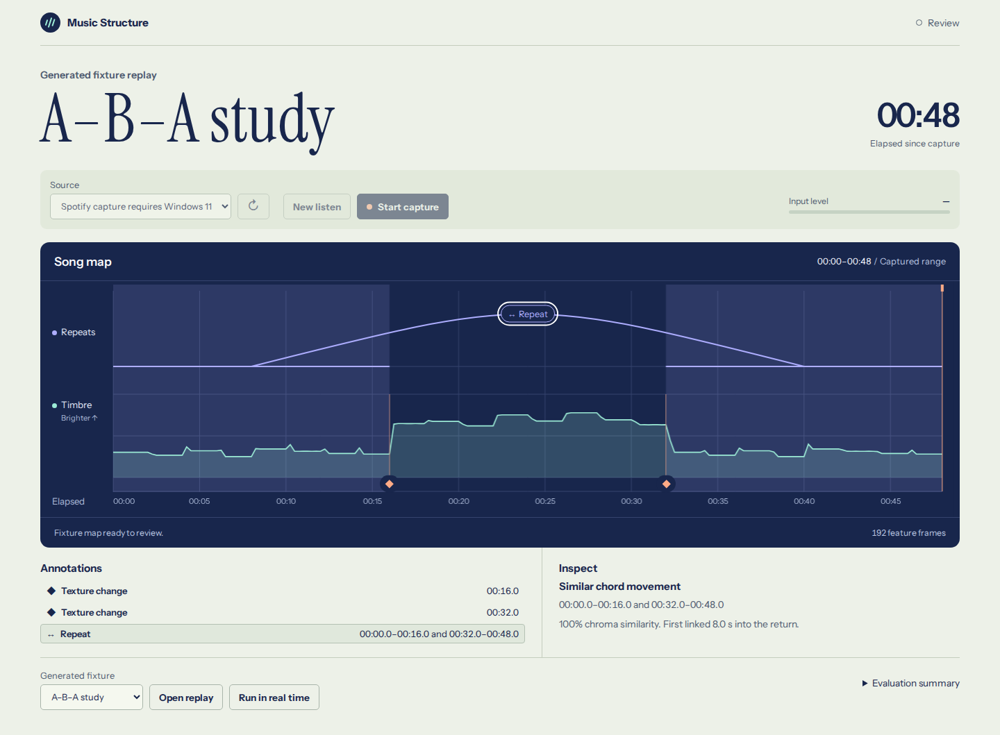
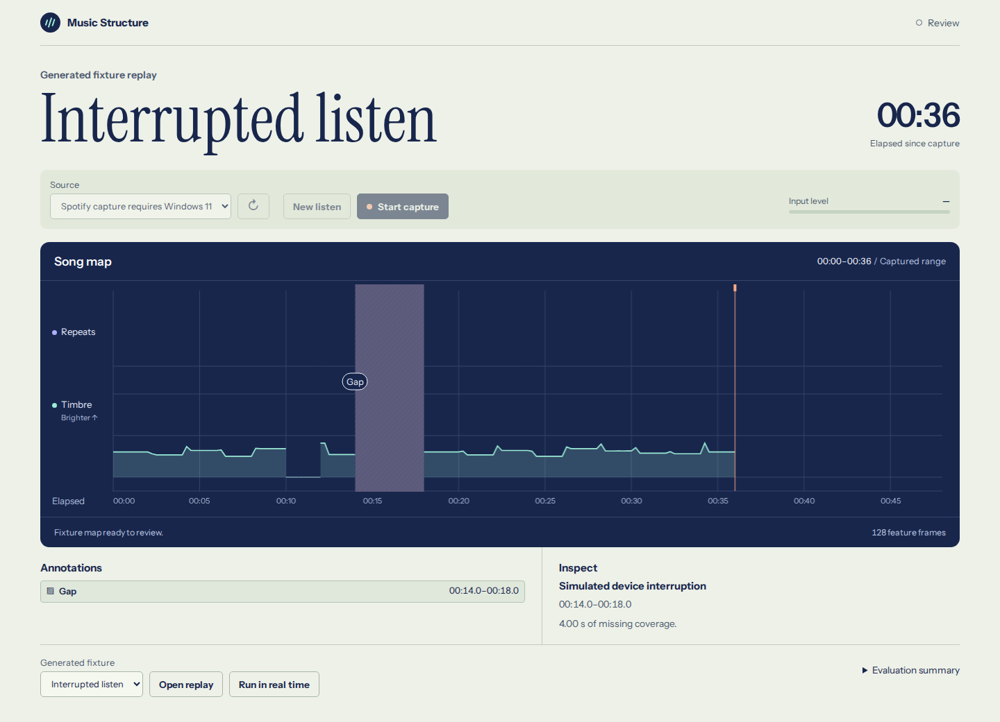

# Windows MVP evidence

The Windows x64 package builds and the generated controls pass. The physical Spotify and Boom 3D trial is open, so there is no listening verdict yet.

## Checks run

- Fedora 44 x64, Node 24.20.0 and .NET SDK 10.0.404. A clean npm install, TypeScript check, Vite bundle, .NET Release build and self-contained `win-x64` publish succeeded. The build script also ran under PowerShell 7.7 on Fedora. The published artifact was identified as a Windows x64 PE executable.
- Headless Chromium loaded the embedded UI from the helper, selected the repeat by keyboard, cleared selection with Escape, inspected a gap, downloaded summaries and fit a 375 px viewport. Wrong Host and Origin requests were rejected. The UI required the local capability, rejected a second listening tab and stopped a running fixture when its tab closed.
- The A–B–A fixture was run through the real-time queue and replayed through the same WebSocket viewer. Its 192 feature frames and annotations agreed after excluding the real-time paint clock. A headless loopback run measured 104.1 ms p95 over 192 aligned paint samples. That run used generated audio on Linux.
- `MusicStructure --verify` checks fixture output and per-run reproducibility, then injects a dropped packet sequence number to verify that the analysis resets and emits a gap. A simulated late packet checks that the audio timestamp and packet read time are preserved separately. The live timing fields and the smoothing toggle passed a Chromium check with generated audio.

| Generated control | Observed |
| --- | --- |
| A–B–A, 48 s | Texture boundaries at 16.0 s (+1,298 Hz) and 32.0 s (−1,177 Hz). One repeat joined 0–16 s and 32–48 s, first visible at 40.0 s of fixture time. |
| Gain step at 10 s | 80 feature frames. The measured level rose by over 10 dB and the detector emitted zero annotations. |
| Silence and interruption | 128 valid feature frames including silent frames, one gap at 14–18 s, and no repeat across the gap. The post-gap material deliberately starts with the earlier harmony to test the guard. |

The threshold set is `score-1`. Timbre uses a 15.5 dB spectral-shape threshold with sustained evidence. Repeats use an eight-second chroma window and a .91 similarity floor, with alignment, movement and local contrast checks. The generated controls informed these settings. With real music, an eight-second fixed window can miss shorter or tempo-shifted returns. The fixed centroid scale is the default. The viewer also offers a relative scale for inspecting smaller brightness changes.

## Listening lab extension

The `score-2` analysis adds events, tempo, tonality and chords. The **Pulse and harmony** fixture covers a change of pulse and key, two short accents, silence and an interruption. The checks found one transient interval at each accent, eight expected chord labels at sampled times, 120 BPM and C major from 14–23 seconds, and 90 BPM and E-flat major from 34–44 seconds. Beat marks agreed with the generated pulse. Silence and the isolated post-gap note yielded unknown harmony and tempo. Mixed-window tonality reported C minor briefly around the modulation, so transition timestamps and labels should be treated as estimates.

## Stopped-score refinement

The `refine-1` pass on **Three returns** grouped 0–12, 22–34.5 and 46–58.5 seconds as family A. Its endpoints were within 0.5 seconds of the planted spans. It found texture boundaries at 12, 22.5, 34.5 and 46.5 seconds. The original pass marked the latter two texture changes and showed two overlapping repeat pairs. The post-gap copy stayed outside the family. The result was deterministic and the original data fingerprint was preserved. The gain control stayed free of refined annotations.

The refinement fixture uses clean, fixed-tempo passages. These results establish behavior under the generated control. Use familiar Spotify songs to evaluate boundary placement and repeating passages in actual listening.

## Chord coverage

The `score-3` chord detector separates bass from higher pitch evidence, estimates pitches between FFT bins, and uses common seventh-chord templates. On **Chord voicings**, the previous detector returned Unknown for all 96 chord-section frames. The revised detector labeled 85 of 96 correctly, including the initial settling period and transitions. The remaining twelve seconds of silence, monophonic bass and an ambiguous cluster stayed Unknown. These are generated results. Spotify coverage and label accuracy remain a listening check.

## Physical measurements pending

| Trial | Status |
| --- | --- |
| Windows shared playback, separate-process isolation and Boom 3D off/on | Unverified. Requires the intended Windows listening machine, Spotify and Boom 3D. |
| Pause, remote Spotify Connect, source restart, output change and exclusive playback | Unverified on Windows. Synthetic packet loss and gap behavior passed. |
| Windows 30-minute capture, paint latency, CPU and memory | Unverified. |
| Two calibration tracks, six held-out Spotify tracks and baseline listening sessions | Unverified. No accuracy or listener preference result. |

Run the [Windows smoke protocol](WINDOWS-SMOKE.md) to fill the physical evidence rows.

## Generated maps

A selected repeat highlights the first and returning spans.

The narrow flat line before the hatched region is observed silence. The hatched region is missing coverage.

